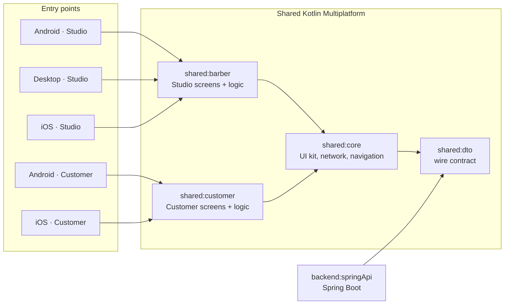
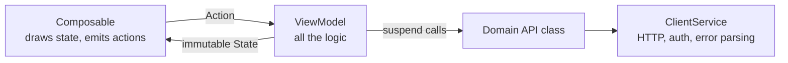
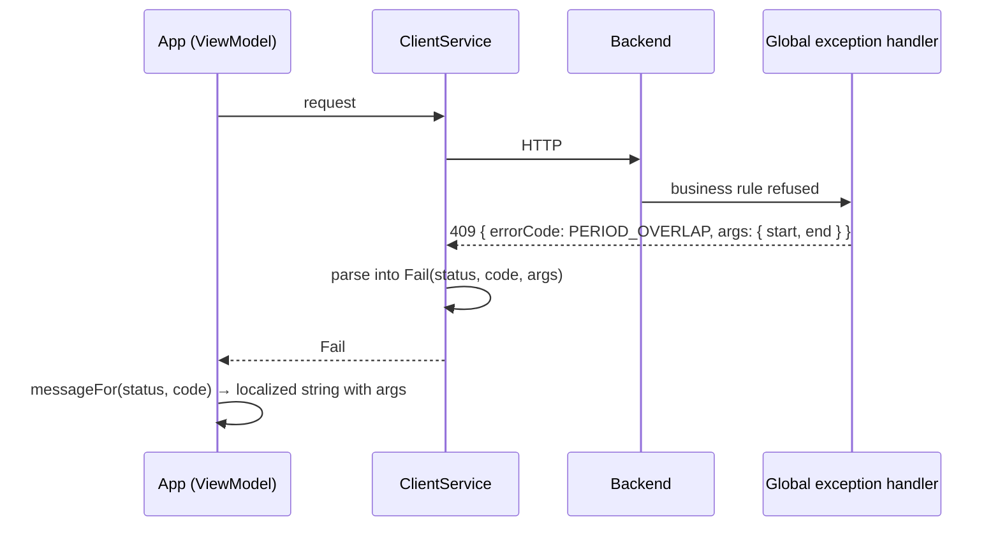
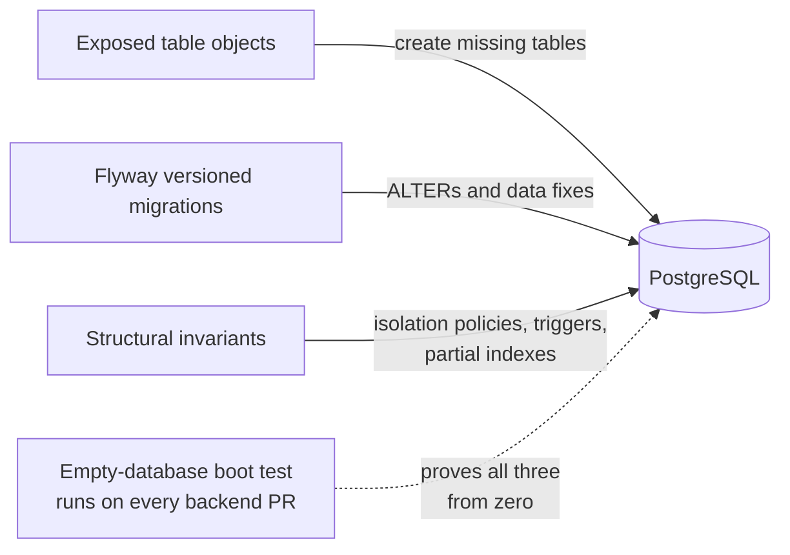
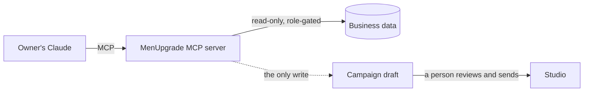
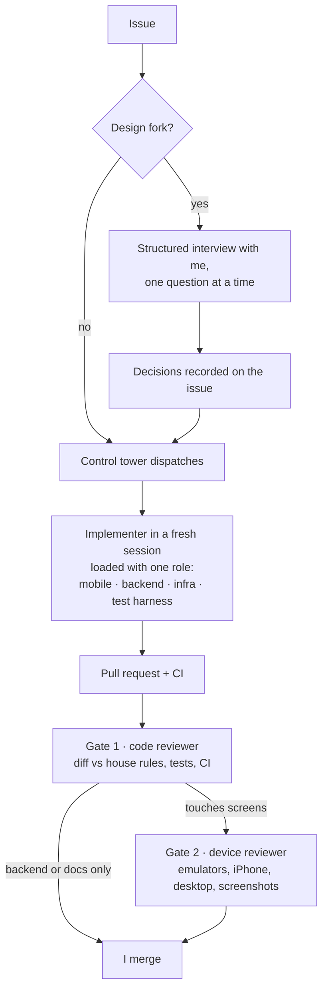

# MenUpgrade — an engineering case study

MenUpgrade is a vertical SaaS for barbershop chains: a customer app, a staff app and the backend behind them. I'm a co-founder and the only engineer. I designed, built and run all of it — mobile, desktop, backend, database, payments, release pipeline and the AI tooling around it.

The source is private. This repository explains how the system is put together and why, with diagrams instead of code.

| | |
|---|---|
| **Apps** | Customer app on Android and iOS. Staff app ("Studio") on Android, iOS, macOS and Windows. One Compose Multiplatform codebase. |
| **Backend** | Spring Boot + Kotlin, Exposed, PostgreSQL, Docker on Google Cloud Run |
| **Data** | Multi-tenant, with isolation enforced by the database itself |
| **Payments** | Stripe subscriptions, cards, Pix and boleto; commissions and tips as append-only ledgers |
| **AI** | An MCP server that lets the owners ask Claude about their business, read-only |
| **Process** | A team of Claude Code agents with fixed roles and two review gates; I own architecture and every merge |
| **Scale of the work** | ~6,900 commits, 900+ merged PRs and 1,300+ issues in 18 months |

---

## Contents

1. [The product](#1-the-product)
2. [One codebase, eight modules](#2-one-codebase-eight-modules)
3. [Every screen is the same shape](#3-every-screen-is-the-same-shape)
4. [Errors are codes, text is born in the app](#4-errors-are-codes-text-is-born-in-the-app)
5. [Tenants are isolated by the database](#5-tenants-are-isolated-by-the-database)
6. [Three authorities over the schema](#6-three-authorities-over-the-schema)
7. [Money that adds up](#7-money-that-adds-up)
8. [Rules the build enforces](#8-rules-the-build-enforces)
9. [AI inside the product](#9-ai-inside-the-product)
10. [AI as the team](#10-ai-as-the-team)
11. [Shipping](#11-shipping)
12. [Scars](#12-scars)

---

## 1. The product

**Customer app.** Booking, subscription plans, family plans, coupons and campaigns, reviews.

**Studio, the staff app.** Schedule, point of sale, commissions, cash flow, performance KPIs and multi-location management, from a single barber's phone to the owner's desktop.

Both apps share one Kotlin codebase. The staff app runs the same screens on a phone, a tablet and a desktop at the front desk.

## 2. One codebase, eight modules

Three rules keep this graph honest:

- **Platform modules are entry points only.** They configure the app and wire dependencies. Every screen and every business rule lives in a shared module.
- **The wire contract is one module, used by both sides.** The backend and the apps compile against the same request and response types, serialized by the same library (kotlinx.serialization on both ends). A field renamed on the server breaks the client build, not the client at runtime.
- **Shared modules compile for Android, iOS and the JVM**, so `java.*` is banned there. Dates go through `kotlinx-datetime`. A test fails the build if a JVM-only import shows up in common code.

## 3. Every screen is the same shape

- **State** is an immutable data class with defaults; lists are `ImmutableList`.
- **Action** is a sealed class of everything the user can do on that screen.
- **ViewModel** holds all the logic and never imports Compose.
- **Composables** only draw. Each one ships with a preview in the same file.

The value is less about MVVM itself and more about uniformity. With more than a hundred screens and several agents writing them, any screen reads like every other. Reviewing one costs minutes, and a test fails the build if a ViewModel imports Compose, if a state holds a mutable list, or if a composable has no preview.

## 4. Errors are codes, text is born in the app

The server never sends a sentence to the user. It sends a **stable code** plus the dynamic parts. The app turns that into text, so the text can be translated without touching the backend.

- **The set of codes is a closed enum in the shared contract module.** The backend can only emit a code that exists, and the compiler rejects an invented one.
- **There is one exception handler on the backend.** The raw exception message goes to the log only, never into the response.
- **There is one mapper in the app**, from code to string resource. Codes without a specific message fall back to a generic one per HTTP status family.
- The screen state has a fixed vocabulary: `error` for a screen-level error, `<field>Error` for a form field, and `<thing>Failed` for a layout flag without text.

## 5. Tenants are isolated by the database

Each barbershop group is a tenant. Isolation does not depend on every query remembering a `WHERE`. **PostgreSQL row-level security enforces it**, so a forgotten filter returns nothing instead of returning someone else's data.

The rule I care most about is that **protection is derived from the model, not written by hand**. A table declares that it is tenant-owned, and its policy is generated at boot. A new table cannot be born unprotected, and an independent check fails the boot if any tenant table is missing its policy.

Code that reads tenant tables goes through one scoping helper, and a test fails the build if a query bypasses it. Jobs that legitimately span tenants have to say so explicitly.

## 6. Three authorities over the schema

| Authority | Owns | Why it's separate |
|---|---|---|
| **Exposed** | creating tables from the Kotlin table objects | a new table is just a Kotlin object, no SQL |
| **Flyway** | every change to a table that already exists, plus data migrations | `CREATE TABLE IF NOT EXISTS` never alters, so drift would be silent |
| **Structural invariants** | isolation policies, triggers, partial indexes | they must hold in every environment, always, and they're regenerated or repeatable |

The test that matters most here boots an **empty PostgreSQL in a container, with a non-superuser role**, and runs the three authorities in the same order production does. It runs on every PR that touches the backend. I added it after a new environment refused to come up (see [Scars](#12-scars)).

## 7. Money that adds up

- **Ledgers are append-only, enforced by the database.** Commissions, revenue, cash and settlements are written once and corrected by new entries, never by edits.
- **Tips live in their own ledger.** They never mix with payments, so they can't leak into commission or revenue math. A test guards that separation.
- **Currency becomes cents by rounding, never truncation.** In floating point `19.99 × 100` is `1998.999…`, and truncating it charges one cent less. A test rejects that pattern anywhere in the backend.
- **There is one business time zone**, anchored to the billing calendar. The backend never asks the machine for its default zone.
- **Price changes reach existing subscribers on purpose**, with a notice period and no surprise proration.
- **Brazilian payment methods are first-class.** Pix and boleto sit next to cards, with a fallback when a method is refused at invoice finalization.
- **Operators never touch the payment dashboard.** Every money operation has an official path in the app, so the books and Stripe can't disagree.

## 8. Rules the build enforces

Conventions written in a document get forgotten, especially when several AI agents are writing code. So the rules that matter are also **architecture tests**: two dozen of them. Each one encodes a house rule and states the limits of what it can catch.

| Area | Examples of what fails the build |
|---|---|
| **Kotlin Multiplatform** | a `java.*` import in common code; an HTTP body whose type is inferred from a non-reified generic |
| **UI** | a ViewModel importing Compose; mutable lists in state; a composable without a preview |
| **Errors** | a non-2xx response without an error code |
| **Data** | a query on a tenant table that skips the scoping helper; a data migration that doesn't declare its scope; a service counting on its caller to open the transaction; a scheduled job that doesn't say how it avoids running twice |
| **Money** | an append-only money table without its database lock; cents by truncation; tips or subscription fees leaking into other ledgers |
| **AI connector** | a connector read running raw SQL without declaring its scope |

Every new rule starts the same way: a bug happened once, and the test makes sure it can't happen twice.

## 9. AI inside the product

The owners connect their own Claude to MenUpgrade through an **MCP server** and ask questions in plain language. How did each location do this week? Which regular customers stopped coming? What's below minimum stock?

- **Read-only by design.** The one write allowed is a campaign *draft* with an inactive coupon. A person reviews it and sends it from the Studio.
- **Only the top role can connect**, and personal identifiers reach the model masked.
- **Routines are versioned like code.** The morning bulletin and the weekly reports are Claude skills kept in the repository. They describe capabilities, not tool names, so they survive a rename. A change goes through a PR, and each partner re-imports it.

## 10. AI as the team

Most of the code is written by Claude Code agents. The architecture, the decisions and the final review are mine. The setup is the result of a few months of measuring what worked and cutting what didn't.

What I learned running it:

- **A permanent identity is not a permanent context.** Roles (mobile, backend, infra, test harness) are reusable skill cards. The worker is a fresh session per issue. Long-lived workers pile up context from ten tasks, and that's where the cost goes.
- **One issue, one implementer, the whole stack.** Most issues cross the contract, backend, ViewModel and UI. Splitting them by layer doubled the context and moved the integration risk to the end. The one split that paid off was the JPA → Exposed migration: five agents in parallel, because the contract was frozen in writing first.
- **One reviewer per PR at a time, split by stage, not by PR.** Code review is cheap and goes first. Device review (emulators, screenshots) is expensive and only runs for PRs that touch screens and already passed the first gate.
- **Decisions live on the issue, not in chat.** Every answer from a design interview becomes a comment on the issue within the minute, so the next agent reads the decision instead of re-deriving it.
- **Rules live in three places, from cheapest to strongest:** the project instructions every agent loads, a persistent memory of traps and decisions, and the architecture tests that make the build fail.
- **Merge is always mine.**

## 11. Shipping

- **One version source.** A single properties file holds the release version, named after the release milestone (`YYYY.MM.PP`), and the build code. A task writes it into the Xcode projects, and the build fails if any file hardcodes a version. Windows installers cap the major version at 255, so the desktop version is derived by a fixed rule.
- **CI runs only what a change touches.** A path filter picks the suites, so a backend-only PR doesn't pay for the multiplatform build. One summary job is the required status check.
- **The manual is code.** The user manual lives in the repository, one book per app. It describes what the code on the main branch does, not what the issue asked for. A PR that changes a flow, a calculation or a visible message updates its chapter in the same PR, and the build validates each chapter's metadata.
- **Deploys are Docker images on Cloud Run**, released by a script.

## 12. Scars

**The migration that worked and changed nothing.** A data migration ran, reported success, was recorded as applied — and updated zero rows. Row-level security applies to the table owner too, and at boot there is no tenant in scope, so the database showed the migration an empty table. No error anywhere. Data migrations now declare their scope explicitly, and a test rejects any that don't.

**The new environment that couldn't be born.** The first time I created a new environment from an empty database, it wouldn't start. Old migrations had been written against tables that no longer existed. Fresh databases now start from a baseline after those legacy migrations. The empty-database boot test runs on every backend PR, so the next break shows up in review, not on deploy day.

**The iPhone bug the JVM couldn't see.** On iOS, logging out never removed the device's push token from the server. Inside a generic inline function, the HTTP library inferred the body type from a non-reified generic. On the JVM that becomes `Object` and works. On Kotlin/Native it's an unconditional null pointer exception, and the request never leaves the phone. CI only ran JVM tests, so it was green. The fix was one explicit type argument, and a test now rejects the pattern.

**The settlement that could be paid twice.** Commission settlements are protected by an append-only lock in the database. An audit found one settlement table outside that list. Deleting its header would have made it possible to close the same period again and pay again. The lock now covers every append-only money table, and a test lists them so a new one can't be forgotten.

**The CI bill that ran out in two days.** The full suite on hosted runners burned the monthly minutes in two days, at about 80 runs a day. The fixes were a path filter so each PR pays only for what it touches, a self-hosted runner, and one full run of the main branch per night instead of one per merge.

---

The code is private. I'm glad to go deeper on any of this in writing. → [LinkedIn](https://www.linkedin.com/in/adrian-del-toro)
